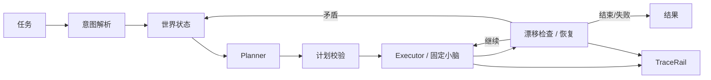
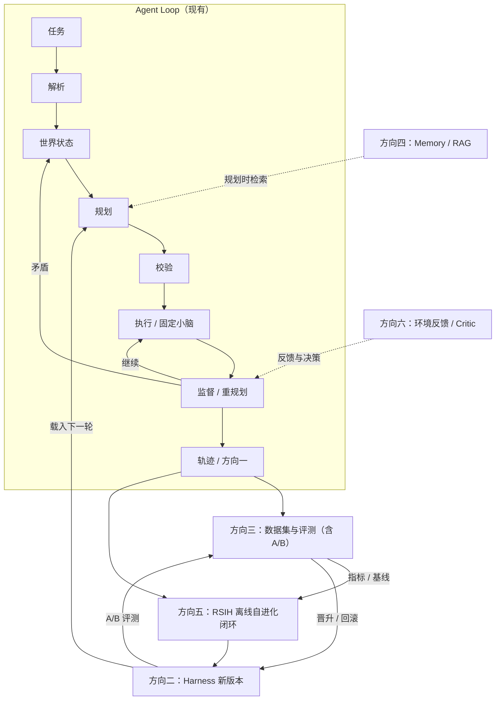

# Agent Loop 与进化规划

> 本文分两部分：一是大脑侧 Agent Loop 的当前基线；二是后续进化的“大方向”规划。
> 每个大方向包含**概述**（做什么、为什么）、**详细内容**（大致要做什么、要定义哪些规范），
> 以及**本方向工作的后续作用范围**（粗描述：这项工作的产出以后会被用在哪，不是要定义的一项规范）。
> 不展开到字段级 schema——字段级规范在各方向落地时另附。
> 小脑固定为 `dig`，`act_exec` 只做旁路对比。
> 术语：`Critic` 专指方向六的决策模块；第一章的 `_drift` 只是漂移检查，不称 Critic。

---

## 一、Agent Loop 当前基线

### 一句话

任务 → 解析 → 世界状态 → 规划 → 校验 → 执行 → 监督/重规划 → 轨迹。

### 循环



1. **任务进入**
   自然语言任务进入 `run_fast_task`；`parse_task` 解析目标、数量、目的地和空间限定。

2. **世界状态**
   `WorldState.snapshot` 汇总状态 token、关节、位姿、地形、能力集、工作包络和已感知位置。

3. **规划**
   `plan_task` 两层：先由 `compile_sequence` 选技能并展开；技能覆盖不了时，
   `compose_actions` 按动作契约推导动作序列。

4. **校验**
   `parse_sequence` 检查动作名、参数、前置状态、绑定字段、返回字段和位置新鲜度。

5. **执行**
   `run_sequence` 逐步派发；快路径经 `ability_manager`，SafetyRail / RecoveryRail /
   TraceRail 生效。小脑当前固定为 `dig`；`act_exec` 只做旁路实验。

6. **监督与重规划**
   每步前 `_drift` 检查实测状态是否与计划前置条件矛盾、位置是否失效；
   矛盾时重新感知并触发 `_request_replan`。

7. **恢复**
   执行失败走 RecoveryRail / 安全撤退；慢路径下 DiagnosisRail 把失败原因带入下一轮模型调用
   （快路径没有逐步模型调用，只记录 trace）。

8. **轨迹与结束**
   `TraceRail` 记录每步工具调用、结果、rail 事件和观测；trace JSON 落到
   `<workspace>/traces/`，帧落到 `frames/<run_token>/`。它的后续作用：
   给 `jiuwensymbiosis-replay` 做回放；给 `trace_feedback` 抽失败、聚类、生成技能补丁建议；
   给 `DiagnosisRail` 提供在线诊断的上下文。
   最后返回 `ok`、`steps`、`plan_tier` 等结果。

### 当前边界

- 大脑只输出动作级计划，不输出关节角或拍级轨迹；怎么动由小脑负责。
- 小脑 v0 固定为 `dig`，`act_exec` 暂不进入主评测。
- 规划过程目前只记录执行步骤；计划序列、尝试、重规划前后等字段待补。
- 后续 RAG、Memory、Critic、自进化等内容在此文档下继续追加。

---

## 二、进化规划（大方向）

在 Agent Loop 基础上，六个方向补成一个进化循环：运行时写轨迹，轨迹经评测和进化引擎产出新 Harness，新 Harness 载入下一轮。



依赖关系：方向二先于方向三（A/B 需要版本）；方向一、二先于方向四；方向一、二、三先于方向五。

### 大方向一：扩充规划级 Trace

#### 概述

规划级 Trace 是**最高层的执行轨迹**，记录一次“任务 → 规划 → 执行 → 反馈 → 重规划 → 结果”的完整回合。
它向下引用/汇总工具级 TraceRail 的执行信息，但不替代 TraceRail——两者是分层关系：

- **TraceRail（工具级）**回答：每个工具调用做了什么、结果如何、耗时多少。
- **规划级 Trace（高层）**回答：为什么这么规划、计划怎么被修正、世界怎么变、最终结果如何。

信息维度不同，消费方也不同：benchmark 主要读规划级；RSIH/自进化两级都要；回放与排障两级一起看。
所以规划级 Trace 要做的不是“再记一份工具日志”，而是把**决策上下文**和**执行明细**组织成一套分层、
可引用、可消费的轨迹。

#### 详细内容

1. **定义 Trace 的分层规范**
   - 事件分层：episode / plan / step / tool / rail / outcome。
   - 明确每层记录的维度：任务与意图、世界状态、规划尝试与校验、执行与结果、重规划与 Critic、版本。
   - 明确规划级与工具级的关系：规划级引用/汇总工具级信息，不重复记录、不允许两级结论不一致；
     用 step id、时间戳、结果摘要做一致性校验。

2. **定义写入时机与存储规范**
   - 何时写：episode 开始/结束、每次规划尝试、每次重规划、每步执行、最终结果。
   - 存储：一个 episode 一份 JSONL；头部放摘要与版本；长数据（帧、大数组）外置并引用。
   - 约束：可回放、可增量追加、坏行不影响整批。

3. **本方向工作的后续作用范围（粗描述，先不锁细节）：规划级 Trace 会被用在哪**
   - **评测**：为 benchmark 提供一次回合的完整上下文与结果（首次通过率、任务成功率、重规划率、恢复率、耗时等）。
   - **自进化**：为 RSIH / 离线分析提供“规划—执行—反馈”的原始材料，供挖掘记忆、技能、工具和策略。
   - **回放与排障**：两级 trace 一起看，先看决策上下文，再下钻到工具明细。
   - **归因**：用于判断一次失败主要属于规划、执行还是环境问题。
   - 以上只是作用范围；具体字段、格式、写入实现等真正落地时再定，避免现在锁死。

#### 交付与验收

- 规划级 Trace 规范文档 + 实现 + 一条完整样例。
- 能从一条 episode 还原：为什么这么规划、计划如何被修正、执行结果如何。
- 工具级细节可通过引用获取，不丢失；需要定义引用与保留策略（TraceRail 有条目/帧上限）。
- benchmark 与 RSIH 都能消费同一份 trace。

---

### 大方向二：Harness 化与版本管理

#### 概述

把运行时可变的部分收拢成一份**可版本化的 Harness**：提示词、工具/动作可见性、技能、记忆/检索、策略、运行时参数都归到它下面。
运行时按版本加载，并把版本记录进 trace。Harness 化不改变当前行为——v0 就等于现在——它解决的是**可复现、可归因、可切换、可回滚**，
同时为后续外部进化器（RSIH）预留写入落点。RSIH 会改哪几个组件是接入之后的事；Harness 本身的结构由本侧先定。

#### 详细内容

1. **定义 Harness 的边界**
   - 属于 Harness：提示词、工具/动作可见性、技能、记忆/检索、策略、运行时参数。
   - 不属于 Harness：硬件驱动、安全联锁（限位、急停、Z 下限等硬规则）、AGX 桥接、小脑实现。
   - 可进化的“策略”只包括恢复/门控等软策略，且必须人审；安全联锁不可进化。
   - 边界要写清楚，否则以后“什么能被进化、什么不能被进化”没有依据。

2. **定义版本与加载规范**
   - 版本标识：每次运行用哪个版本，可追溯、可对比。
   - 等价性：Harness v0 必须通过行为等价测试（同任务、同 seed、同结果），确认收拢配置没有改变行为。
   - 加载时机：一次运行只载入一次、版本钉死，不允许运行中途混用两个版本。
   - 校验与回滚：新版本加载前校验，出问题能回退到上一个版本。

3. **预留外部写入接口**
   - 为后续适配器/loader 预留形状：外部进化器产出的新版本能被校验、加载、回滚。
   - 现在不实现适配器，只要求 Harness 可替换、可校验、可回滚。

4. **本方向工作的后续作用范围（粗描述，先不锁细节）：Harness 版本管理会被用在哪**
   - **可复现**：同版本跑出同样的行为；每次运行记录 `harness_version`。
   - **可归因**：成功/失败能归到具体版本；A/B 只比较版本差异。
   - **可切换**：改行为不改代码；不同任务或机体用不同 Harness 版本。
   - **可回滚**：新版本出问题能回退到上一个版本。
   - **可进化**：为外部进化器（RSIH）提供写入落点——Memory / 技能 / 工具 / 策略 / 提示词的更新都落到新版本。
   - **可复用**：跨机体、跨场景复用同一套 Harness 结构；组件取值按机体/场景实例化，技能和动作内容不直接复用。
   - 以上只是作用范围；组件字段、加载实现、适配器形态等落地时再定。

#### 交付与验收

- Harness 规范（边界、版本、加载、回滚）+ Harness v0（等价当前行为）。
- 切换版本能改变行为；每次运行记录 `harness_version`；新版本失败可回滚。

---

### 大方向三：数据集与评测

#### 概述

建一套 AGX 规划数据集和评测口径，用来测量“当前规划器”和“优化后的规划器”。
数据集的最小单元是一次规划回合（episode）：任务 + 初始状态 + 参考计划 + 成功判据 + 元数据。
它测的是**大脑规划**——小脑固定 `dig`，任务成败由独立真值判定，不依赖 `dig` 的返回值；
系统级成功率单独统计，并标注小脑版本。
数据靠**程序化生成 + 自动校验**，不需要人工逐条标注。

#### 详细内容

1. **定义 episode 的内容**
   - 一条 episode 记录一个完整回合：任务、初始状态、参考计划、成功判据、元数据。
   - 具体例子：任务“把左边土堆挖两斗倒到右边 3 米”；初始状态——土堆在机器前方 3 米、斗空、机器在原点、具备挖掘能力；参考计划——读地形 → 挖(3,0→6,0) → 挖(3,0→6,0) → 回安全位；成功判据——两次挖卸完成、铲斗质量过阈值、无安全违规；元数据——后端、随机种子、版本号。
   - 元数据：描述这条数据本身的信息（后端、种子、版本号、来源、创建时间等），不参与任务内容，用于复现、筛选和归因。
   - 规划可以有多条合法路径，所以成功判据看“目标是否达成”，不是逐字比对参考计划。

2. **定义数据来源**
   - 任务话术：人工写一批任务模板（单斗、多斗、先移动再挖等）。
   - 场景参数：按随机种子采样土堆位置、目标点、机器姿态、斗状态。
   - 参考计划：用脚本专家生成，或从验证过的成功轨迹中提取；排除测试集轨迹，记录来源与版本。
   - 自动校验：参考计划先过静态校验，再在 mock 中执行确认。
   - 扰动：注入超距离、斗里有料、地形变化等情况，用于考重规划和恢复。

3. **定义任务分类与划分**
   - T1 单斗 / T2 多步 / T3 长程 / T4 扰动 / T5 OOD，每类覆盖不同的规划能力。
   - 划分按任务模板和场景进行；测试集冻结，不进入知识库，也不进入 RSIH。

4. **定义两种后端**
   - mock：内存假机器，没有物理，速度快；用于大量生成和运行，主要验证计划是否正确。
   - remote：真 AGX，有物理，速度慢；用于 20–30 条验收，确认真实物理下的结果；这是验收子集，不做统计显著性结论。
   - 两种后端的结果不混在一起统计；每条数据记录用的是哪种后端。

5. **定义评测指标**
   - 计划层面：一次通过率、需要修改的次数、非法动作/参数、前置条件违反。
   - 执行层面：任务成功率、单步成功率、重规划次数、扰动后的恢复成功率。
   - 长程与代价：长任务完成进度、总耗时、大模型调用次数。
   - 安全：安全拒绝次数、危险计划放行率（必须为 0）。
   - 泛化：OOD 与普通题目的成功率差。
   - 自进化效果：新版本相对基线的变化、旧数据上是否退步。
   - 后端适用性：计划层面指标在 mock/remote 都可用；任务成功率、单步成功率、物理效果只在 remote 上统计，并标注小脑版本。
   - 口径：mock 只判计划是否正确；真实成功看 remote 真值；每个结论用多个随机种子；测试集冻结。

6. **定义小脑替换**
   - 题目和成功判据与小脑无关；成功用环境真值判定。
   - 换小脑 = 新增一个小脑版本，同一批题重跑，结果分开记录。
   - 新小脑需要图像或动作粒度变化时，再补充观测字段和参考计划。
   - 规划级指标跨小脑可比；系统级成功率只在同一小脑版本内比较。

7. **本方向工作的后续作用范围（粗描述，先不锁细节）：数据集与评测会被用在哪**
   - **测当前规划器**：给出基线水平（一次通过率、成功率、重规划率等）。
   - **测优化**：同一批题对比优化前后的规划器（Memory / RAG / Harness 版本）。
   - **测自进化**：每轮进化后用同一批题验证，检查提升与退步，支持回滚。
   - **测小脑替换**：换 ACT / VLA 后同一批题重跑，比较系统级效果（与小脑版本绑定）。
   - **测泛化与长程**：OOD、长程、扰动，作为能力边界。
   - **统一口径**：给大脑、小脑、仿真三方提供同一套评测语言。
   - 以上只是作用范围；题量、字段、指标口径等落地时再定。

#### 交付与验收

- 第一版：20–50 条 episode + 指标口径 + 当前基线。
- 第二版：200–500 条（T1–T5）+ 20–30 条 remote 验收；固定种子可复现；测试集冻结。

---

### 大方向四：Memory / RAG / 知识库

#### 概述

建一套供规划使用的知识库和检索机制：把系统内的结构化知识（动作/技能契约、状态、能力）、技能文档、
成功与失败轨迹，以及外部专家文档，整理成可检索的条目；规划时按任务、世界状态和能力过滤后注入 Planner。
知识库是方向二定义的 Harness 组件之一——落点和版本管理由方向二提供；知识来源主要来自方向一的 trace，
效果由方向三的评测验证。检索结果只作提示，最终计划仍要过校验。

#### 详细内容

1. **定义知识来源与分类**
   - 内部结构化知识：动作与技能契约、状态 token、能力集、配置包络（从代码导出，权威、随版本重建）。
   - 内部经验知识：成功计划、失败修复、重规划对（从 trace 提取，需要验证和去重）。
   - 外部知识：作业流程、专家规划方案、约束规则、排障手册、领域背景（需要切分、挂接、标注适用范围、人审）。
   - 分类的目的：不同来源的信任级别、更新方式和适用范围不同，检索时不能混在一起。

2. **定义知识入库规范**
   - 每条知识记录：内容、来源、涉及的动作/技能/状态/能力、适用范围（机体/场景/版本）、置信度、时间。
   - 外部知识入库：切分 → 挂接到现有本体 → 标注适用范围 → 人审 → 入库。
   - 经验知识入库：只收验证过的成功；失败修复要有对应 trace 证据；去重、按时间衰减。
   - 测试集相关的轨迹与计划不入库，防止泄露。

3. **定义检索与注入规范**
   - 自研部分：查询怎么构造（任务 + 当前世界状态 + 能力集 + 机体/配置版本）、硬过滤（能力门、前置状态、适用范围）、注入格式（带来源的“历史经验 / 外部参考”，不直接当可执行计划）、最终校验（仍过 `parse_sequence`）。
   - 复用部分：相似度计算、索引与检索、重排的实现交给成熟组件；排序公式里的业务权重（历史成功率、新近度、来源可信度）由本侧定。

4. **定义更新与治理**
   - 自动更新：轨迹沉淀（成功计划、失败修复）只生成**候选更新**，验证、去重、衰减后进入新知识库版本；不修改当前运行使用的快照。
   - 人工入库：外部文档与专家方案，人审后进库；与代码/配置/契约冲突时，以代码/配置/契约为准，外部知识只作提示。
   - 版本化：知识库随 Harness 版本走，可回滚；每次检索记录用了哪些条目。
   - 隔离：测试集永久隔离，不进知识库、不给 RSIH。
   - 外部文档进入 RSIH 的路径：先入库为 memory 条目，RSIH 通过“知识库状态”读取，不直接读原始文档。

5. **本方向工作的后续作用范围（粗描述，先不锁细节）：知识库与检索会被用在哪**
   - 给 Planner 提供经验与外部知识，减少重复推导。
   - 给 RSIH 提供记忆目标：它可以提议新增、修改或淘汰知识条目。
   - 给评测提供检索效果指标（命中率、贡献度）。
   - 具体字段、嵌入模型、存储选型落地时再定。

6. **定义实现方式（可复用成熟组件）**
   - 通用部分优先复用成熟方案：解析、切分、嵌入、向量检索、混合检索、重排、检索评测。
   - 自研只保留领域层：本体挂接（动作/技能/状态/能力）、能力与状态过滤、注入格式、校验与治理。
   - 存储与模型按规模选型；规模不大时用简单方案即可，不为了“先进”上重框架。
   - RAG 实现可替换，不影响动作契约、校验和规划接口。

#### 交付与验收

- 第一版：结构化知识 + 基线成功/失败轨迹入库 + 检索注入；在方向三的评测上做基线对比。
- 第二版：外部文档与专家方案入库；检索效果指标；与 Harness 版本打通。
- 验收：检索后首次通过率或成功率有提升或至少不退化；不引入安全违规；测试集不泄露。

---

### 大方向五：RSIH 离线自进化闭环

#### 概述

建一个离线自进化闭环：每一轮用现有轨迹和固定评测集，交给“进化引擎”产出对 Harness 的修改提案，
人审后形成新 Harness 版本，再用评测决定晋升或回滚。
当前引擎用 RSIH，但它的进化方法会被持续优化、甚至替换——所以本方向的核心是**把引擎与运行时之间的接口定下来**：
引擎怎么读（输入契约）、怎么写（输出契约）、怎么被验证（评测门禁）。
引擎内部怎么挖模式、怎么生成提案，是引擎自己的事，不进入运行时。

运行时和引擎之间只通过两个适配器连接：

```text
运行时（trace 格式、HarnessSpec）
   │  输入适配器：trace → session
   ▼
引擎（RSIH / 后续可能换的进化方法）
   │  输出适配器：Genome / 提案 → HarnessSpec
   ▼
运行时（加载新版本 → A/B → 晋升或回滚）
```

#### 详细内容

1. **定义引擎的位置与边界**
   - 引擎离线运行，不进入实时 Agent Loop。
   - 引擎只能改 Harness 组件（memory / skill / tool / policy / prompt / runtime 参数）；
     不能改驱动、安全硬规则、小脑实现、AGX 桥接。
   - 引擎可替换：RSIH 只是当前实现；接口不变就能换方法。

2. **定义输入契约（引擎读什么）**
   - 规划级 trace（方向一）与执行明细引用。
   - 评测结果与指标（方向三）。
   - 当前 Harness 版本与知识库状态（方向二、四）。
   - 历史提案及其评测结果（由方向三统一产出，按固定格式供给引擎）。
   - 禁止输入：测试集、未验证的数据、跨版本混在一起的运行结果。

3. **定义两个适配器（用它们把运行时和引擎解耦）**
   - 输入适配器：把 trace/episode 转成引擎能读的 session——任务、计划尝试、执行、重规划、结果、AGX 真值、版本；按场景/工作区分组。
   - 输出适配器：把引擎产出的 Genome / 提案转成 HarnessSpec（方向二）。只映射 instructions / tools / skills / policies / runtime / memory 六个组件，其余 Genome 组件忽略或拒绝；负责校验、生成新版本、支持回滚。
   - 解耦是双向的：运行时改 trace 字段或 Harness 结构，只影响适配器；引擎改进化方法或读取方式，也只影响适配器。两边都不改对方的内部实现。
   - 输入/输出契约是稳定接口；适配器放哪一侧可以调整（RSIH 侧也能改读取方式），但契约不变。

4. **定义输出契约（引擎写什么）**
   - 提案内容：目标组件、改动内容、证据（哪些轨迹/统计）、预期效果、风险、回滚方式。
   - 提案必须可校验：加载器能校验、能生成新 Harness 版本、能回滚。
   - 引擎不直接改运行时；写文件和生成版本由加载器（方向二）执行。

5. **定义闭环流程与轮次**
   - 一轮 = 收集轨迹 → 引擎分析 → 产出提案 → 人审 → 生成新版本 → 评测 A/B → 晋升或回滚 → 记录结果。
   - 每轮限制改动数量，便于归因。
   - 晋升条件：目标指标提升或至少不退化；安全违规为 0；成本在预算内。
   - 回滚：新版本失败回到上一版本；失败提案作为负证据保留。

6. **定义引擎自身的反馈与版本**
   - 每次运行记录引擎版本（RSIH 版本与配置）与 Harness 版本。
   - 记录每个提案的最终结果（晋升/回滚、指标变化），作为引擎改进的数据。
   - 引擎方法改变时，固定 Harness 和评测集，只比较引擎版本；Harness 改版时，固定引擎版本，不要同时变。

7. **本方向工作的后续作用范围（粗描述，先不锁细节）：进化闭环会被用在哪**
   - 让 Harness 在记忆、技能、工具、策略、提示词上持续改进。
   - 为引擎优化提供数据：提案 → 结果 → 反馈。
   - 为团队提供可审计的进化记录。
   - 提案格式、轮次频率、自动化程度落地时再定。

#### 交付与验收

- 第一版：输入/输出契约 + 一轮闭环跑通（引擎产出提案 → 人审 → Harness v1 → A/B → 晋升/回滚）。
- 第二版：记录引擎版本与提案结果；至少两轮迭代；引擎可替换（换方法不改运行时）。
- 验收：新版本有可验证的提升或至少不退化；失败可回滚；测试集未泄露。

---

### 大方向六：环境反馈与长程接口 / Critic

#### 概述

大脑给小脑下指令后，不能“发完就不管”。它需要知道两件事：
小脑执行得怎么样（做到哪一步、有没有失败、是否真的完成），环境变成了什么样（铲斗有没有料、地形变没变、底盘到没到位）。
没有这些反馈，大脑后续的规划就是盲的，只能按原计划硬走。
这个方向就是建立这条反馈通道，并让大脑据此决定继续、重新感知、重规划还是停止；
长程任务也按里程碑推进，而不是等一整段动作结束。

#### 详细内容

1. **定义反馈什么**
   - 小脑返回：动作是否完成、当前阶段、进度、是否铲上过料、失败原因、耗时。
   - 环境返回：铲斗质量、地形变化、底盘位姿、关节状态。
   - 频率：每个动作一次汇总；长动作低频上报进度；大脑不接收关节级/拍级数据。

2. **定义怎么判断动作有没有效果**
   - 大脑在计划里写明“这一步应该产生什么效果”，执行后拿实际结果对照。
   - 例如：计划挖一斗，执行后铲斗质量没上去，就说明这一步没成，不能继续下一斗。
   - 不能只看动作返回 `ok`；动作成功不等于目标达成。

3. **定义大脑收到反馈后做什么**
   - 正常完成：进入下一步。
   - 没效果、失败、偏离：重新感知、重规划、有限重试或停止。
   - Critic 判断“计划还成不成立、有没有跑偏、有没有进展”；Fast Gate 决定“继续、重新感知、升级 Planner、还是停止”。
   - 恢复：重试、切换执行策略、重规划、终止；同一失败不原样重复；不绕过安全护栏。

4. **定义长程任务怎么推进**
   - 大脑只输出动作级计划，用循环、条件、里程碑表达长程；不输出拍级/关节级时序。
   - 里程碑用任务级目标（完成斗数、铲斗质量、地形变化、装载→卸载序列），不用状态 token 充当进度。
   - 需要等待/重试时，用动作级语义（wait/retry/max_iters），不写死延迟。
   - 支持取消/超时，长动作可中断。
   - 主评测固定 `dig`，`act_exec` 切换只在旁路实验。

5. **定义怎么验证**
   - 数据集增加长程和扰动类别（方向三的 T3/T4）。
   - 指标：里程碑完成率、重规划率、恢复成功率、重复失败次数、总耗时。
   - 用故障注入验证“大脑能不能根据反馈做出正确决定”。

6. **本方向工作的后续作用范围（粗描述，先不锁细节）：反馈与 Critic 会被用在哪**
   - 长程任务：多斗、导航+作业、条件触发。
   - 小脑替换：VLA/ACT 提供 progress/phase 后，大脑能监督更长的动作。
   - 安全恢复：失败后不重复、不越界。
   - 评测：把恢复能力和长程能力纳入统一指标。
   - 具体字段、阈值、Critic 实现方式落地时再定。

#### 交付与验收

- 第一版：反馈字段 + “动作有没有效果”的检查 + 基础决策（继续/重规划/停止）。
- 第二版：Critic / Fast Gate、恢复策略、长程任务与故障注入评测。
- 验收：长程任务成功率/恢复率提升；重复失败次数下降；大脑计划中不出现关节级动作。

---

## 三、实现方式：最小闭环 → 延申

每个方向都按三层推进：v0 最小闭环（一条端到端、可验收的最小链路）、v1 扩展范围、v2 完善机制。
先证明机制成立，再扩覆盖面，最后做自动化和治理，避免一开始就把所有细节做满。

### 方向一：扩充规划级 Trace
- v0：一个 episode 一份 JSONL，记录任务、计划、每步结果和版本；能回放。
- v1：补规划尝试、校验错误、重规划前后；与 TraceRail 建立引用和一致性校验。
- v2：统一 benchmark/RSIH 消费格式，处理保留策略、坏行、增量写入。

### 方向二：Harness 化与版本管理
- v0：一份 manifest（prompt / tools / skills / memory / policies / runtime），加载后行为与当前一致，记录版本。
- v1：支持组件覆盖、版本切换、回滚；补行为等价测试。
- v2：跨机体复用、外部写入接口、与 RSIH 适配器打通。

### 方向三：数据集与评测
- v0：20–50 条单斗/多步 episode + 4 个指标（首次通过率、成功率、重规划率、每斗耗时）+ 基线。
- v1：T1–T5、200–500 条、mock/remote 分工、测试集冻结。
- v2：OOD、扰动、统计显著性、多小脑版本对比。

### 方向四：Memory / RAG / 知识库
- v0：契约知识 + 基线成功/失败轨迹 + 简单检索注入 + A/B。
- v1：外部文档与专家方案、检索排序与重排、治理与版本化。
- v2：知识图谱、自动更新候选、检索效果指标、跨机体复用。

### 方向五：RSIH 离线自进化闭环
- v0：一条闭环：trace → 输入适配器 → RSIH 提案 → 人审 → 输出适配器 → Harness v1 → A/B → 回滚。
- v1：多轮迭代、引擎版本对比、AGX 语义分析、提案结果反馈。
- v2：引擎可替换、自动化程度提高、更多 Harness 组件可进化。

### 方向六：环境反馈与长程接口 / Critic
- v0：通用反馈契约（`effect_ok` / `failure_code` / `state_summary` / `recoverable`）+ 一个 `check_effect` 钩子 + 一个具体动作的效果检查 + 不一致时重规划 + trace 记录。不绑定某一个例子；其他动作后续注册检查函数即可。
- v1：覆盖所有动作的后置条件、低频进度、取消/超时、长程里程碑。
- v2：Critic、Fast Gate、恢复策略、故障注入评测、VLA 长动作监督。

---

## 后续大方向（暂无）

- 后续新增方向在此追加。
